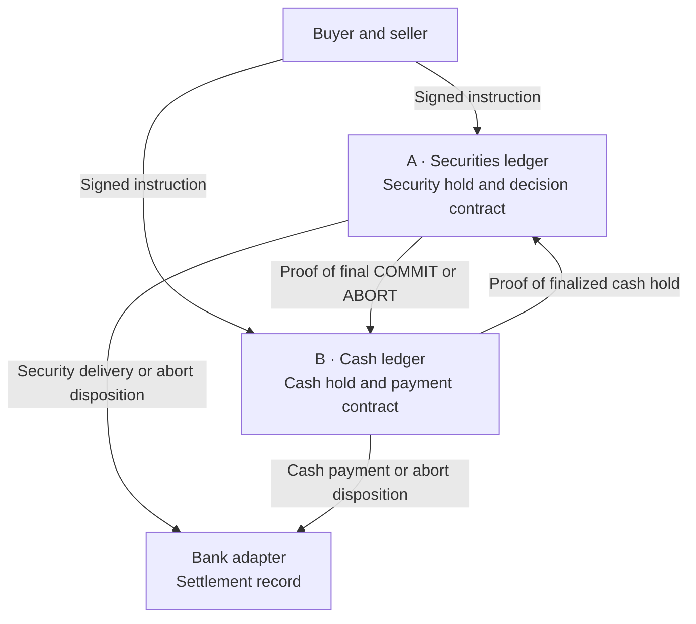
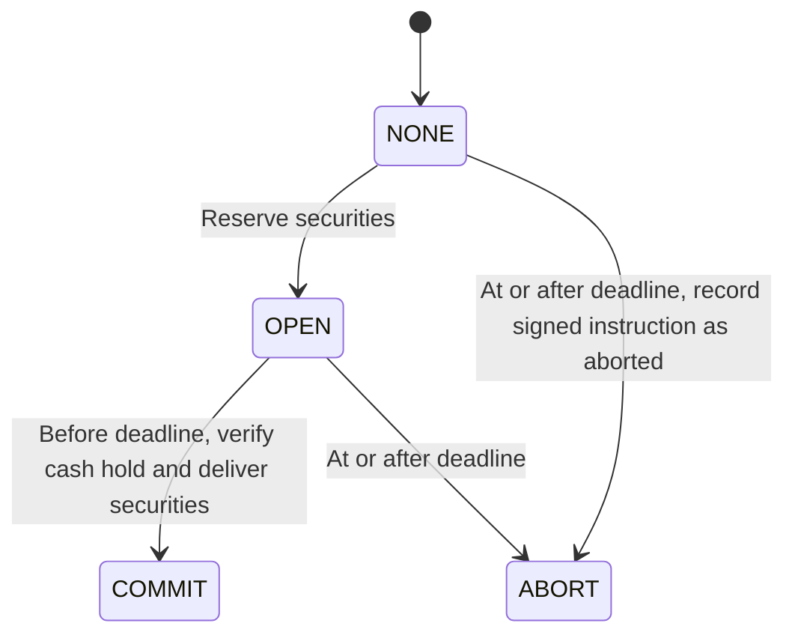

# Native-asset delivery versus payment

Two institutions exchange securities for cash. Each asset stays on its issuing ledger. The buyer and seller sign one trade descriptor specifying the ledgers, contracts, assets, amounts, accounts and decision deadline.

## Protocol architecture

In a cross-ledger trade, **A** is the ledger that issues the security and owns the decision. **B** is the ledger that holds the buyer’s cash and pays the seller. Proof workers capture finalized events and relayers carry their proofs between ledgers. Each receiving contract verifies the proof against the signed trade and the admitted source before it acts. The bank adapter uses authenticated records from both ledgers to reconcile the trade. [Architecture and responsibilities](verification/protocol.md#placement-and-responsibility)

The roles are assigned per trade. Either X or Y can host the securities leg. If both assets are on the same ledger, both transfers settle in one local transaction. Overlapping trades share native balances, and an outstanding reservation reduces the amount available to the next trade. [Four placements and concurrent transactions](verification/SPECIFICATION.md#physical-ledgers-and-concurrent-routes)

## Trade state machine (STM)

**Decision on A.** The diagram follows one signed cross-ledger trade. Opening it reserves the seller’s securities in the same transaction. The deadline is measured in A’s block height. Both terminal decisions are irreversible.

**Cash on B.** B can reserve cash before A opens the trade. The first finalized reservation on either ledger admits that exact trade across an authority rotation. After rotation the other ledger needs proof of that reservation to continue under the old terms. B stores A’s verified decision independently of its local cash hold.

| B’s cash hold | Event at B | New state and effect |
| --- | --- | --- |
| `AVAILABLE` | Authorized preparation with sufficient available cash | `PREPARED` — reserve the signed amount. |
| `PREPARED` | Apply verified COMMIT | `DELIVERED` — consume the hold and pay the seller exactly once. |
| `PREPARED` | Apply verified ABORT | `REFUNDED` — release the hold to the buyer. |
| `AVAILABLE` | Learn ABORT before preparation | No hold exists. B remembers ABORT and rejects later preparation for this trade. |

After ABORT each ledger releases any local hold when it can process the decision. B’s own clock cannot authorize a refund. After COMMIT, a halt on B leaves the cash reserved until payment can resume. The bank adapter records `FULLY_APPLIED` only with evidence of both deliveries. To close an ABORT it needs the authenticated decision and evidence from each ledger that its hold was released or never existed. [Quint transitions](verification/models/dvp.qnt) · [Decision, application and recording](verification/SPECIFICATION.md#three-distinct-guarantees)

## Settlement guarantees

| Property | Checked behaviour |
| --- | --- |
| Decision | Each instruction has one permanent outcome. COMMIT requires the exact funded cash obligation and atomically delivers the security. |
| Recovery | After a cross-ledger COMMIT, the seller’s cash remains reserved during a cash-ledger halt. If that ledger recovers, remains available and fairly services the pending payment, the seller receives the full amount exactly once. Both directions are checked. |
| Financial records | FULLY_APPLIED requires evidence for both native deliveries and a record matching the signed terms. ABORT completion requires release or verified absence of each obligation. |
| Finality | The banks’ rules determine whether final COMMIT or final cash credit discharges the buyer’s debt. The finite model sets no elapsed-time bound for a halted ledger. |

The reference uses native holds. The models also cover alternative decision hosts, escrow, shared execution, private assets and membership changes. Model results apply to the assumptions, configurations and transitions identified in each check. Real QBFT, EVM contracts, proof circuits, token controls and bank integration have separate conformance obligations. [Model assumptions](verification/assumptions.md) · [Protocol variants](verification/variants.md) · [Two-network conformance](verification/reports/guarantee-conformance.md)

## Specification and verification

- [Properties and proof boundaries](verification/properties.md)
- [Protocol lifecycle and checks](verification/coverage-contract.md)
- [Settlement and recovery evidence](verification/reports/settlement-evidence.md)
- [Quint models](verification/models) and [directed tests](verification/tests)
- [Verification commands and toolchain](verification/README.md)

Run the source-bound evidence audit from the repository root with `python3 -B verification/scripts/verify.py audit`.
