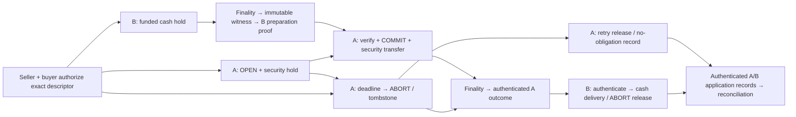

# qmodel

Published repository: [JekaMas/qmodel](https://github.com/JekaMas/qmodel).

Executable Quint investigation of native-asset cross-chain delivery-versus-payment. The project executes the attached v2 brief against the recovered shared solution, using the pinned Quint LLM kit language/modeling skills and local Quint, Apalache and TLC tooling.

**Result.** The settlement model verifies one terminal outcome per trade, delivery only after COMMIT, refund only after ABORT, single consumption of each hold, and two matching backed obligations at COMMIT. It also verifies eventual application under its stated recovery and fairness hypotheses. Independent ledgers can make one leg locally usable before the other. The [Question 8 evidence review](verification/reports/interview-summary.md#question-8-evidence-review) maps Stage A to the actual model checks and Stage C to the directed cases and remaining PoC tests.

**Funded blocks.** Three eligible reservations included on each ledger succeed in every local execution order when their combined demand fits available funds. The A decision block can commit all three at the last legal height with zero free securities because the holds are already funded. B applies all three authenticated outcomes in its own block. Partial funding rejects only the excess local requests. [Block execution model and results](verification/reports/funded-blocks.md)

**Three-trade faults and races.** The bounded profiles exercise nondeterministic admission/decision, independent clocks, durations, overlapping outages, selective partitions, and malicious delivery. Checkers distinguish actual mixed recovery, Byzantine certificate thresholds, hostile queue policy and local SQLite linearization. The [stage matrix](openspec/changes/check-three-trade-faults/fault-matrix.md) and [verification record](verification/reports/three-trade-faults.md) state the exact proved, sampled and external scopes.

**Composed protocol checks.** The seven open verification products now have selected results. TLC checks the N3 job pipeline under hostile load, independent clock and confirmation rates, Byzantine authority across rounds and one membership change, and paired public requests. Directed checks cover B/D/shared effects and two logical contract histories. Symbolic induction establishes hold and balance safety for the extracted economic rules at any finite population, with actual action comparisons at N=3 and N=5. The [results and proof limits](verification/reports/proof-products.md) distinguish the exact configurations and controls.

**Repeated exchanges.** The workload runs COMMIT, funded ABORT and a later COMMIT on the same ledger pair, then three fully funded parallel exchanges. It executes all 90 legal orders of their paired decision and remote application actions. All 45 core actions have an evidence disposition. The [repeated-settlement review](verification/reports/repeated-settlement-review.md) records the exact failure domains, retained assumptions and state space limits.

**Current validation.** [Strengthened settlement guarantees](verification/reports/guarantee-validation.md) closes VGR-01 and VGR-02. Nine TLC profiles check authoritative outcome and evidence-backed booking, including two competing trades and recovery. Seven matching temporal results now imply eventual evidenced booking. The added prior-state check tests actual admission and terminal immutability. A small SQLite projection exercises restoring and replaying exact COMMIT records with authenticated evidence fixtures.

The earlier four comparative-review repairs cover exact disclosure provenance, program admission at the consumer, actual ABORT resolution, and account/asset/amount binding. All seven formerly deferred checks completed. The authenticated-OPEN hold/effect induction passed, TLC reproduced both architecture counterexamples, and three fault samples of 10,000 traces found no violation of `safe`. The exact-source replay set includes 47 executions with 46 matching negative traces. [Validation record](verification/reports/qa-validation.json) · [Repair report](verification/reports/qa-repairs.md) · [Property review](verification/reports/qa-properties.md).

The [independent review](verification/reports/independent-review.md), [commented solution specification](verification/SPECIFICATION.md) and [changes made for each guarantee](verification/reports/solution-and-changes.md) explain the original findings, repairs and resulting solution.



A hosts `SecurityHold`, `DvPDecision` and `BPreparationVerifier`; B hosts `CashHold` and `AOutcomeVerifier`. Assets stay native. Controlled local signers submit already authorized operations; untrusted relayers transport evidence, and proof workers capture finalized historical state. Neither a relayer acknowledgement nor an adapter projection authorizes value movement.

The exclusive deadline belongs to A: COMMIT requires `height < D`, ABORT requires `height >= D`. Holds persist until an authenticated outcome. A signed ABORT tombstone resolves a trade that never opened; B keeps terminal knowledge even before its hold exists. A late authentic preparation cannot reverse ABORT. Refund failure cannot prevent the durable ABORT decision.

| Contract | Result and conditions | Tradeoff |
|---|---|---|
| C-Decision | One permanent authorized outcome with actual reserved/delivered backing; A COMMIT and security delivery are one local atomic action | A orders the reference outcome and is an availability dependency |
| C-Local | Both native applications eventually complete with retained evidence/data, recovered required actors, supported asset powers and per-action fairness | An asynchronous interval of one-sided local usability exists; permanent halt/freeze can prevent progress |
| C-Records | FULLY_APPLIED and reconciliation require authenticated source application evidence and exact financial terms; ABORT requires actual releases or terminal no-obligation records | Ledger delivery, recipient usability and bookkeeping are distinct milestones |
| Private usability | Delivered private value additionally needs its exact recipient note and key | Irrecoverable key/data loss defeats usability |
| Scoped privacy | Two actual protected positions yield equal selected-observer response histories under the checked coupled schedule and ideal opaque naming/private channels | Permitted routing, phase, equality, size and timing metadata remain visible; entitled recipients/regulators can learn authorized data |
| Conditional time | Explicit finite queue/inclusion/outage assumptions yield slot bounds; the D=15/D=14 boundary is tested | Slots are model assumptions, with no production latency, gas or throughput claim |

A-hosted native holds remain the reference. Authenticated OPEN, B/D decision placement, escrow, private assets, three independent domains and HTLC/root/shared-ledger/committee controls are separately named models. D adds a governance/availability dependency and two preparation plus two outcome proof paths; it does not synchronize native balances. A shared execution ledger can apply co-resident assets atomically, at the cost of changing the execution-domain premise. Native holds require admitted durable token semantics; escrow requires explicit vault/custody semantics. ZK-style remote authentication is modeled symbolically and does not establish real circuit correctness or hide ordinary EVM state from local validators.

The four obligations from the original timeouts have separate completed results. Apalache checked reference safety through depth 12. Exhaustive reference TLC covered 12,502 states at graph depth 38 and therefore includes all reachable safety prefixes through depth 20. The two-trade TLC graph checked safety and conditional progress over 684,268 states with all proof phases. The one-trade TLC recovery graph checked safety and conditional progress over 125,632 states with B/prover outages and B freeze/unfreeze. The longer SMT20 attempts and original 180-second timeouts retain their recorded non-success statuses. See the [exact results and assumptions](verification/reports/interview-summary.md#question-8-evidence-review).

Start with [the final review](verification/reports/final-review.md), [findings](verification/reports/findings.md), [coverage](verification/reports/coverage.md), [native counterexamples](verification/reports/counterexamples.md) and [the exact execution index](verification/reports/executions.md). See the [guarantee-assurance task and progress](openspec/changes/strengthen-dvp-guarantees/tasks.md) and [two-network conformance cases](verification/reports/guarantee-conformance.md). The [source inventory](verification/sources/source-inventory.json) records recovered sources and missing original materials. The [canonical task record](openspec/changes/verify-cross-chain-dvp/tasks.md) contains execution status and limits.

```sh
npm ci
python3 verification/scripts/verify.py baseline
python3 verification/scripts/verify.py negative
python3 verification/scripts/verify.py audit
```

These commands audit the complete acceptance selection using the saved backend observations and source closures. They fail on missing/corrupt evidence, wrong backend verdicts or changed final model hashes. They deliberately do not rerun already valid greens. Add `--fresh` to explicitly execute every selected check again against its exact recorded input version; every subprocess has the recorded resource/time limit and failures propagate. The baseline contains positive checks. The negative suite requires actual property violations. The complete audit also checks directed witnesses of faulty producers and the exact new acceptance selection. Use `python3 verification/scripts/replay.py mutant-expiry --latest-success` to reproduce one counterexample and compare native ITF states.

Fresh checking requires Node, Python 3 and Java 21+ (Java 25 was used here). Quint 0.33.1 is pinned in package-lock.json; the first fresh verification may fetch project-local Apalache 0.62.4 and Rust evaluator v0.7.1 into `.quint`. No global install is needed. See [verification instructions](verification/README.md) for Java selection, limits and proof boundaries.

The standard workflow is pinned at `.agents/workflow`. If the historical upstream pin is unavailable, restore it from the bundled exact Git history using `python3 .agents/restore-workflow.py`. The pinned local source bundle was smoke-tested in a temporary clone. Copied Quint kit skills are in `.agents/skills/quint-lang` and `.agents/skills/quint-modeling`; revision and licenses are in NOTICE and the source inventory.

Models, evidence, source copies and reports are published under JekaMas/qmodel. The [repair validation record](verification/reports/qa-validation.json) identifies the historical focused source and the full validation results. The [extended publication receipt](verification/reports/publication-extended.json) and [earlier publication receipts](verification/reports/publication.json) retain the previously published source identities, hosted readback and fresh-clone reproduction; they are historical receipts. There is no production blockchain, real asset movement or funded infrastructure. The versioned source seal is a local evidence trust anchor, not third-party execution attestation. Ten early observations lack saved source closures; their exact availability and current replacement scopes are listed in verification/reports/reproduction-availability.json. Historical timeout attempts remain immutable. The final review and coverage report identify their extended-run resolution separately from the original receipts.
