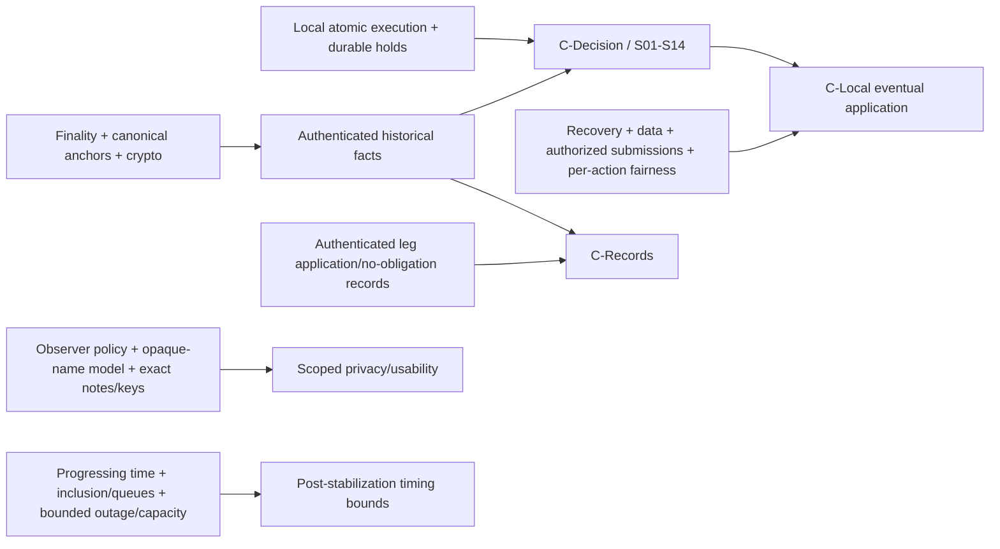

# Assumption/guarantee graph

Local checks are explicit transition rules. External correctness, recovery, policy and bound hypotheses remain conditional. Individual perturbations do not establish a globally minimal assumption set.

| ID | Owner / role | Interval | Dependents | Guarantee | Enforcement / monitoring | Executed controls |
|---|---|---|---|---|---|---|
| A-FINAL | Source domain / external trust | pending historical outcomes | S02, S06, S08, S10 | Correct finality and non-equivocation of admitted canonical history | Accepted source genesis/checkpoint, predecessor-authorized configuration and immutable finalized provenance are checked locally; source quorum correctness is external. | tlc-equivocation-canonicalAcceptance, auth-execution_rejects_history |
| A-EXEC | Local contracts / external trust | all actions | S01, S04, S05, S08 | Correct atomic local EVM execution and exact supported token behavior | Single-ledger all-or-nothing transitions and supported hold/token methods; real Solidity/EVM execution is an external conformance obligation. | mutant-non_atomic, auth-direct_bad_execution, auth-execution_rejects_invalid |
| A-CRYPTO | Proof implementer / crypto idealization | signature creation through verification | S03, S06, S10 | Ideal signatures, commitments and proof soundness with structured bindings | Complete descriptor signatures and structured proof public bindings are enforced by guards; actual encoding/circuits/crypto remain external. | scenario-bindings_test, mutant-binding, mutant-relayer_assertion |
| A-HOLD | Issuer governance / stakeholder choice | prepare through terminal application | S04, S07, S08, L02 | Admitted token semantics preserve pending obligations | Admit only documented durable hold/escrow semantics; freeze pauses required application, cancellation is coordinated before COMMIT, arbitrary seizure is excluded from the guarantee. | tlc-issuer_destruction-backed, tlc-mandatory_freeze-progress, tlc-arbitrary_seizure-backing |
| A-RECOVERY | Chain/service operators / admissible environment | eventual suffix | L01, L02, L03, L04 | Eventually required dependencies remain operational | Operational monitoring/redundancy may support the hypothesis but cannot guarantee recovery from a permanently failed ledger. | final-record-recovery, overclaim-permanent-halt |
| A-FAIR | Scheduler/operators / admissible environment | eventual suffix | L01, L02, L03, L04 | Weak fairness for each continuously enabled per-trade/per-phase recovery action | Per-trade/per-phase weak fairness, not aggregate-step fairness; real retry/queue scheduling must implement it. | queue-capacity-progress, tlc-starvation-boundedCompletion |
| A-DATA | Evidence store / enforceable local control | capture through application/retention | L02, S13 | Durable evidence or reconstructible finalized history remains available | Capture immutable finalized evidence durably before pruning; use retained program/checkpoint history, and do not confuse adapter restoration with witness recovery. | scenario-recovery_test, trust-v2-witness_loss, network-loss-recovery |
| A-SUBMIT | Custody/submission owner / enforceable local control | decision/application | L01, L02, L03 | At least one already authorized submission path can progress | Custody/transport/validator/upgrade/decryption roles are separate; provision at least one already authorized progress path. | trust-v2-insufficient_submitters, trust-v2-committee_refusal |
| A-OPAQUE | Crypto abstraction / crypto idealization | privacy executions | P-NI, P-Binding | Content-bound opaque roots preserve equality/retry links under an explicit correspondence; no computational privacy proof | Observation rules preserve stable trade links and opaque-name equality; low-entropy guessing, logs and timing are separate leak controls. | linked-privacy-privacy_safe, linked-privacy-witness_log, tlc-unsalted-PNI |
| A-POLICY | Institution/compliance / stakeholder choice | disclosure/audit | P-Access, P-Scope | Selected observer policy and audit scope are explicitly configured | Actual payload constructors check role/field/surface and scoped audit metadata; institutional authorization choices remain external. | tlc-privacy_safe-PAccess, tlc-wrong_scope-PAccess, audit-omitted_record |
| A-ANCHOR | Verifier governance / enforceable local control | admission through pending historical application | S10, S13 | Canonical chain/contract/program bindings are admitted by predecessor authority; retire only without destroying pending completion. | Local manifest, threshold approvals, historical verification and consumed identity retention. | trust-v2-trust_safe, trust-v2-retired_version, membership-retirement-final, membership-consumed-replay |
| A-KEY | Recipient/data custodians / admissible environment | private delivery through actual use | P-Availability | Exact delivered note plus key access remains recoverable. | Bind note to actual transition; monitor delivery/key custody. No magic reconstruction from COMMIT. | private-data-progress, private-permanent-key-loss, negative-disclosure_key_compromise, negative-wrong_note |
| A-TIME | Ledger/service/scheduler operators / admissible environment | after explicit stabilization | T-Bounded | Bound every queued phase, inclusion, finality, delivery and permitted outage; explicit progressing time and relation to A height. | Finite phase/queue monitors and round-robin scheduling; production latency must be measured independently. | exact-deadline-margin, one-less-deadline-margin, post-stabilization, tlc-frozen_time-timeProgress, tlc-no_inclusion-boundedCompletion |
| A-CAP | Admission and worker control / enforceable local control | admission through recovery drainage | T-Capacity, L01, L04 | Finite reserved exposure, finite identities and hostile FIFO budget; pending accepted jobs eventually serviced under recovered fair service. No priority/composed deadline claim. | Admission cap two and hostile-work budget two in capacity model; queue jobs consume real modeled slots. | queue-capacity-progress, tlc-unlimited-exposure, tlc-starvation-boundedCompletion |
| A-BOUNDS | Model author / abstraction/bound | each exact checked configuration | S01, L01, P-NI, T-Bounded | Finite one/two trades, integer units, finite program epochs, bounded fact phases; specialized three-domain installation and paired worlds. | Exact input closures and bounds in receipts; no parameterized theorem or general composition inferred. | final-record-two, three-domain-installation-final, linked-privacy-privacy_safe |
| A-ABORTRECORD | Source-ledger adapter and evidence store / crypto idealization | ABORT application/no-obligation capture through booking | S06, S15, L04, C-Records | Authentic canonical finalized local read produces descriptor/leg/genesis/checkpoint/program-bound refund or no-obligation record. | Source-local capture; recordAbort requires both source records and authentic A outcome. This is a required interface, not arbitrary relayer/RPC trust. | abort-authoritative-records, final-record-progress |

Exact outcomes/commands are in [executions](reports/executions.md); source authentication does not prove issuer solvency, real EVM/QBFT correctness, or legal discharge.
