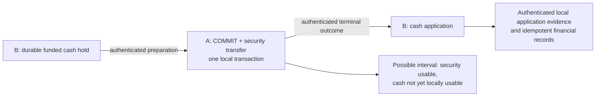

# Protocol review

The reference design can provide irreversible, correctly backed commitment with conditional eventual local application in the checked finite models. It cannot provide immediate joint local usability across asynchronous independent ledgers. The distinction is a requirement/architecture decision, not a missing prover optimization.

## What the checked design relies on

The security hold and cash obligation must survive admitted issuer/contract/version operations. Historical finalized proofs remain authentic; safety comes from persistent obligations, immutable decisions and exact binding, not a check that the source still looks identical. A decides only using received B evidence plus its local checks. B applies/refunds only from persistent authenticated terminal knowledge. The model now also requires authenticated local application/no-obligation records for ABORT bookkeeping.

A's exclusive height boundary orders the outcome. Independent B expiry is unsafe even when the old B proof is authentic. The abort tombstone handles missing OPEN, and persistent B knowledge prevents an already learned ABORT from being discarded before a late prepare. Authenticated OPEN adds a proof but does not eliminate historical-OPEN/late-preparation races.

Local token failure must revert A's complete COMMIT transaction. ABORT itself must survive a failing refund. No new discretionary counterparty consent is required after commitment; an authorized submission path, supported token behavior, data and legally permitted application still must recover.

## Architecture comparison

- **A-hosted:** one remote preparation verification and one return outcome verification on the minimal success path. Security becomes locally usable first. A is an ordering/availability dependency.
- **B-hosted:** the corresponding cash-first placement. Remote registration was separated from A reservation during model review; B uses local cash and authenticated A preparation.
- **Separate D:** two authenticated preparations and two independently authenticated return paths. D is another ledger/availability/governance dependency; COMMIT on D does not itself deliver either native leg.
- **Authenticated OPEN:** three remote verifications on the chosen normal path, including OPEN, and historical-open races remain.
- **Native hold versus escrow:** both preserve capacity in the admitted semantics, but balances/control sit differently. Legal title and insolvency protection do not follow from a state label.
- **Private cash-state variant:** ledger application is separate from note/key usability. Ordinary local EVM visibility and selective remote evidence are the simpler baseline; private tokens are an evaluated alternative, not a deployment mandate.
- **Shared execution control:** both assets are explicitly co-resident on one chain/genesis and transfer in opposite directions in one transaction. This meets the local atomic-update control under its assumptions; it does not preserve the original two independently operated native asset ledgers by magic.
- **HTLC/root-signalling/committee representatives:** the executed models have narrow stated interfaces. They do not verify all HTLCs, arbitrary GPACT trees, or any named vendor's implementation.

## Trust and intervention

Direct consensus and ZK-wrapped consensus retain trust in admitted source execution/asset semantics. The ideal execution-validity interface rejects invalid execution, but still needs canonical history and correct guest/crypto assumptions. A compromised verifier administrator or sufficient attestation committee can break its respective trust boundary. A mandatory committee or authorized submitter can remain an availability dependency.

Supported freezing preserves holds and pauses required movements; new preparations reject local freezes. Coordinated pre-commit cancellation and arbitrary post-commit seizure are modeled separately. Permanent freezes/data/key/chain loss can defeat stronger progress/usability claims. Calling a system regulated is not a proof of a particular legal policy, and compensation is not original atomic settlement.

## Composition and scale

The principal one-trade economic projection has a checked finite safety simulation to the algebraic core; induction is scoped to that core and finite scalar domains. It is not a liveness-refinement theorem. Other focused models share interface contracts and have separately executed small integrated configurations, not a blanket verified composition. The three-domain installation has real independent progress/availability and domain-bound outcome messages. General n-leg exchange and the full parameter/fault/privacy/time Cartesian product remain unverified.

The official [Quint checker documentation](https://quint.sh/docs/model-checkers) separates simulation, bounded checking and finite graph checking. The observed results use those distinct meanings. The [hyperproperties reference](https://arxiv.org/abs/1401.4492) motivates comparing executions; this project's coupled-schedule paired result is narrower than general noninterference. The [explicit-time reference](https://www.microsoft.com/en-us/research/publication/real-time-is-really-simple/) motivates time variables, not a production latency claim.

## Independent-review corrections

The original payload privacy monitor did not establish the mandatory source-data/response relation. Its replacement privacy_pipeline models two actual states, immutable witness/proof data, full public response projections and internal-only Issue provenance; the 12-operation schedule and optional shared request remain deliberately finite. Actual timed outputs and typed-note key progress have separate checks. Fresh replay and sealed claim/raw/source/tool contracts close reproduction/evidence defects. These repairs strengthen the investigation rather than upgrade its economic atomicity contract. See independent-review.md and solution-and-changes.md.
