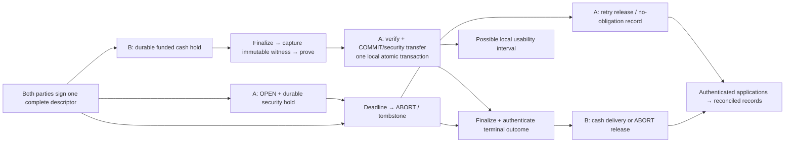

# Resulting solution and changes made for its guarantees

The result is an executable formal investigation of the proposed native-asset DvP overlay, with an explicit repaired control policy and scoped guarantees. It is not a new production settlement implementation. The source answer's asynchronous architecture remains the reference: A orders the decision and delivers security locally; B later applies authenticated COMMIT or ABORT to its cash hold.

| Change from the initially represented design/model | Purpose and affected properties | Result / qualification |
|---|---|---|
| Complete 22-field signed descriptor and independent local eligibility | S03/S10/S14: reject altered identities, quantities, accounts, domains and versions | Direct binding/admission cases; principals and ledger-local accounts remain distinct |
| Native availability accounting and explicit escrow vault movement | S01/S04/S05: conservation, exclusive capacity and exact economic effects | One/two-trade core and escrow checks; no duplicated reserved balance |
| Immutable included/finalized/captured facts | S06/S07/S08/S10: authentic old proof is not magically refreshed or invalidated by a new source state | Delayed historical OPEN/preparation/outcome and pruning/restart cases |
| Exclusive decision-height deadline and permanent signed tombstone | S02/S09/S11/L01/L03: one outcome, missing-OPEN resolution, no independent B expiry | Independent B expiry fails against stale authentic preparation; safe candidate uses authentic outcomes |
| Persistent terminal knowledge before a hold exists | S11/L03: early ABORT is not discarded; late unknown preparation remains resolvable | Known/unknown ABORT and delayed OPEN races exercised |
| Atomic local COMMIT + actual security transfer; ABORT separate from refund | S05/S08/L03: rollback and retry do not create an unbacked decision | Non-atomic and stale-refund mutants fail; local rollback/refund-failure witnesses pass |
| Authenticated application/no-obligation records | S06/S15/L04/C-Records: bookkeeping does not inspect live remote state or invent refunds | Authenticated COMMIT/ABORT reconciliation checks; canonical finalized local-read interface is explicit |
| Separate B/D registration, local outcome knowledge and actual shared chain identity | Cross-ledger locality and architecture-independent C-Decision | Required placements checked; shared execution is a separate co-resident-assets control |
| Pending-safe/current-safe retirement and durable consumed IDs | S13: offboarding/upgrades preserve application without granting old credentials new admissions | Genuine current-epoch prune failure preserved/replayed, minimal control-policy repair checked |
| Per-trade/per-phase fairness and explicit recovery hypotheses | L01–L04: rule out starvation assumptions hidden inside aggregate fairness | Conditional finite temporal checks; fairness does not promise pre-deadline COMMIT |
| Replacement privacy state/payload pipeline (IR-001) | P-Access/P-Binding/P-NI/P-Timing/P-Availability: observations derive from real modeled source data | Full returned payload separated from private provenance; current positive and seven leak controls executed |
| Forced, exact-attempt replay and immutable native exports (IR-002) | A fresh command really executes; one attempt is not compared to a later attempt's shared trace | Distinct process receipts, matched immutable exports where available, explicit unavailable early closures |
| Sealed proof contract/raw/source identity and live runtime observation (IR-003) | Wrong property/command or corrupted evidence cannot satisfy the selected claim | Reviewer's forged-claim discriminator is rejected; zero selection and corruption controls added |
| Corrected timing/capacity scope (IR-004) | T-Bounded/T-Capacity: do not infer hostile-work or priority latency from a two-trade workload | Original 14/22/24 timing retained; separate actual hostile FIFO service/overload/recovery witnesses |
| Full finite-choice SMT expansion | Preserve the entire full-reference transition relation while improving solver representation | Parsed-AST certificate checks identical state/init and all 61 shared primitive alternatives, including phases 0–6; no safety assumption or job restriction |
| Fault-phase rejection/recovery witnesses | S06/S12/L02/L03: explicitly attempt blocked work while a required actor is down | 19 capture/prove/transport/submitter/ledger cases; retained captured witness permits proving while B is down |
| Accepted/registered diagnostic fields | S15: a signature alone does not imply accepted source work or a registered decision | Six scenarios distinguish unsigned, authorized, accepted cash hold, OPEN, tombstone and rejected frozen admission; the view is a source-world diagnostic |
| Current assumption-to-evidence links | Correct privacy dependency rows that still cited retired monitor results | Current repaired full-payload/typed-note observations are cited and audited; historical evidence is retained |
| Preserve actual native-export links in the manifest | Keep each saved native path/checksum available alongside descriptive notes | The audit checks actual export files/hashes; no original receipt or trace is rewritten |
| Comments and full specification | Make ownership, oracle fields, assumptions and non-equivalence reviewable | [Specification](../SPECIFICATION.md), inline comments and comment-only retention record |

The reference meets **C-Decision** under its admitted assumptions and supports **C-Local eventual application** under recovery/data/submission/fairness. It does not meet instantaneous joint local usability. **C-Records** requires its own authenticated evidence. Private delivered commitments additionally require exact note/key access. Permanent halt, freeze, seizure, data loss, committee/submitter refusal or changed trust assumptions have their own reproduced failure controls.

The broad timeout configurations and production external obligations remain visible. The [independent review](independent-review.md) records baseline findings and final dispositions; [executions](executions.md) identifies exact observations. No protocol guarantee is upgraded merely because this repository is documented or published.
